# rsPostman user manual

rsPostman is an API client that runs entirely on your computer. You build HTTP requests,
organise them in collections, test the responses with scripts, run whole collections, mock
and benchmark APIs – from a graphical window or from the command line. Nothing is sent to a
cloud service: collections, environments, history and secrets are files in a folder you own.

This manual describes the graphical interface first and the command line at the end. The
same text is available inside the application: press **F1** or the **?** button in the top
right corner.

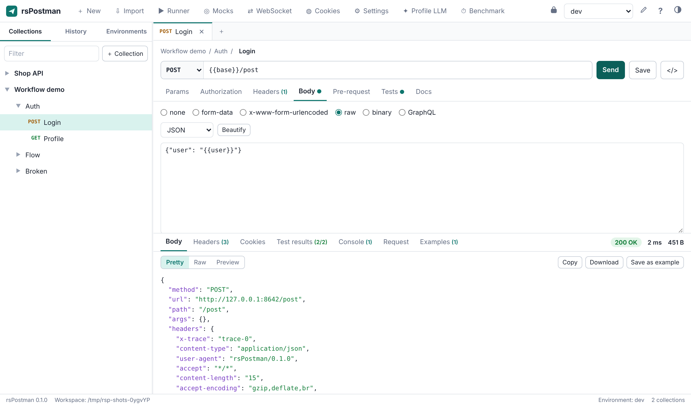

## Getting started

### Starting the application

There are three ways to run rsPostman. They show the same interface and can share one
workspace.

| How | Command | Notes |
|---|---|---|
| In your browser | `rspostman gui` | Starts a local server and opens `http://127.0.0.1:8686`. Use `--port N` for another port and `--no-open` to not open the browser. Stop it with Ctrl+C. |
| Desktop window | `rspostman-desktop` | The same interface in its own window. |
| Command line only | `rspostman <command>` | See [Command line](#command-line). |

To build from source you need Rust: `cargo build --release` produces `target/release/rspostman`;
`cargo build --release -p rspostman-desktop` produces the desktop application (it needs the
system webview libraries, for example `libwebkit2gtk-4.1-dev` on Debian and Ubuntu).

### The workspace folder

Everything you create is stored in the *workspace folder*: `~/.rspostman` unless you choose
another one with `--workspace DIR` or the `RSPOSTMAN_HOME` environment variable. The folder
in use is shown in the status bar at the bottom of the window. You can keep separate
workspaces for separate projects, back the folder up, or put collections under version
control – see [Files on disk](#files-on-disk).

### Your first request

1. Press **New** in the toolbar (or Ctrl+N). An empty request tab opens.
2. Type a URL, for example `https://httpbin.org/get`, and press **Send** (or Enter in the URL
   field, or Ctrl+Enter anywhere in the tab).
3. The response appears in the lower half: status, time, size and the body.
4. Press **Save** (Ctrl+S), give the request a name and choose or create a collection.

> No internet at hand? Run `rspostman echo` in a terminal. It starts a small test server on
> `http://127.0.0.1:8642` with endpoints such as `/get`, `/post`, `/status/404`, `/delay/200`,
> `/basic-auth/user/pass` and a WebSocket echo at `/ws`. The examples in this manual use it.

### Getting help

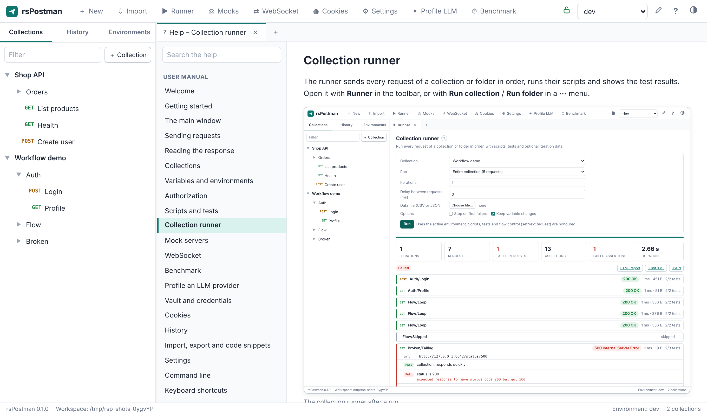

Press **F1** or the **?** button at the top right to open the Help Center: this manual and
the scripting reference, with a list of topics on the left and a search field above it. It
works offline. Tool pages have a small **?** beside their title that opens the matching
chapter.

## The main window

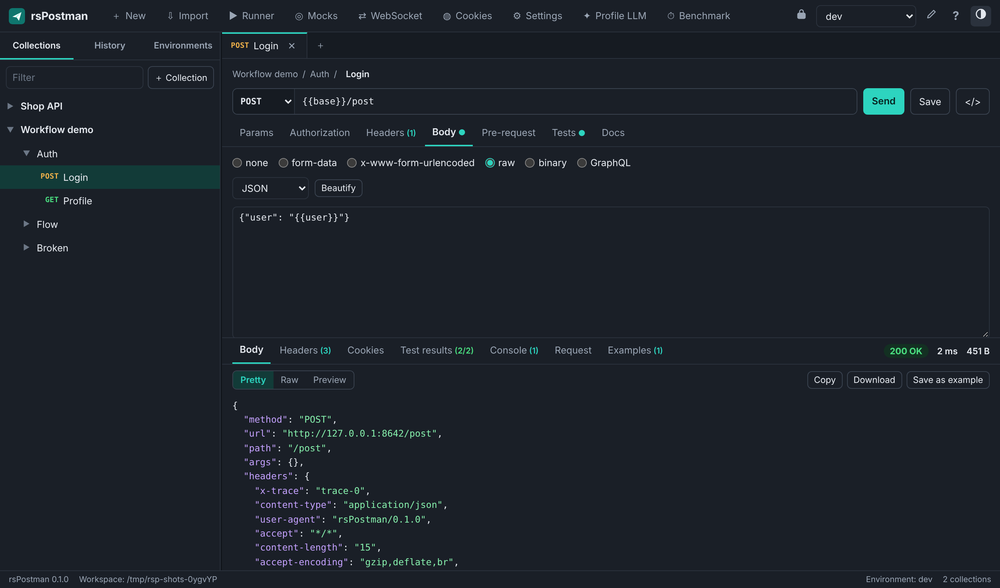

| Area | What it is for |
|---|---|
| **Toolbar** (top left) | **New** request, **Import**, and the tools: **Runner**, **Mocks**, **WebSocket**, **Cookies**, **Settings**, **Profile LLM**, **Benchmark**. |
| **Top right** | The padlock opens the [vault](#vault-and-credentials); the drop-down selects the active [environment](#variables-and-environments); the pencil edits it; **?** opens this help; the half-moon switches between light and dark theme. |
| **Sidebar** (left) | Three tabs: **Collections** (your saved requests as a tree), **History** (what you sent), **Environments** (variable sets and Globals). Drag the edge to resize it. |
| **Tabs** | Every request, editor and tool opens in a tab. An orange dot marks unsaved changes. **＋** opens a new request. |
| **Request editor** (upper half of a request tab) | Method, URL, **Send**, **Save**, **</>** (code snippet), and the sections Params, Authorization, Headers, Body, Pre-request, Tests and Docs. |
| **Response viewer** (lower half) | Body, Headers, Cookies, Test results, Console, Request and Examples. |
| **Status bar** (bottom) | Version, workspace folder, active environment, number of collections. |

Pages that belong to a tool have a small **?** next to their title; it opens the matching
chapter of this help.

## Sending requests

### Method and URL

Choose the HTTP method from the drop-down in front of the URL and type the address. A URL
without a scheme is sent with `http://`. You can use `{{variables}}` anywhere in the URL –
see [Variables and environments](#variables-and-environments).

If you paste a `curl` command into the URL field, rsPostman converts it into a request
(method, URL, headers, body and basic or bearer credentials).

### Query parameters and path variables

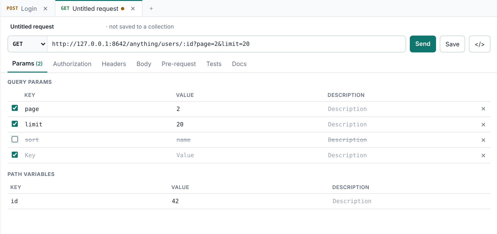

The **Params** section and the URL stay in sync: typing `?page=2` in the URL adds a row,
editing a row rewrites the URL. Untick a row to keep it without sending it.

A path segment that starts with a colon, such as `/users/:id`, is a *path variable*. It
appears in a second table where you give it a value; the value replaces `:id` when the
request is sent.

### Headers

Add headers as key/value rows in **Headers**. `User-Agent`, `Accept`, `Host`,
`Content-Length` and a `Content-Type` matching the body are added automatically unless you
set them yourself. Values of headers that look like credentials (`Authorization`, `Cookie`,
`X-Api-Key`, names containing *token*, *secret* or *password*) are shown as dots; the eye
button reveals them.

### Body

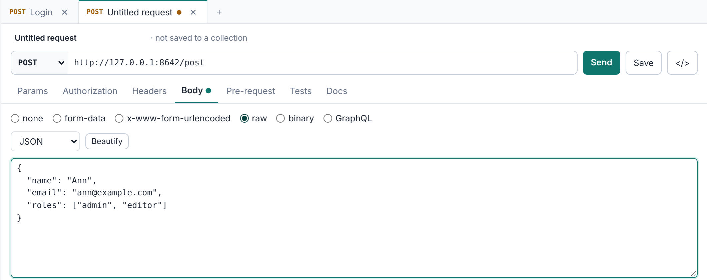

| Body type | Use it for | Notes |
|---|---|---|
| **none** | Requests without a body. | |
| **form-data** | File uploads and multipart forms. | Set a row's type to **File** and press **Choose…** to pick a file, or type its path. |
| **x-www-form-urlencoded** | Classic HTML form posts. | Keys and values are URL-encoded for you. |
| **raw** | JSON, XML, HTML, text or JavaScript. | Pick the language to set the `Content-Type`. **Beautify** re-indents JSON and XML. |
| **binary** | Sending one file as the whole body. | The content type is guessed from the file extension. |
| **GraphQL** | A query plus variables. | Sent as JSON `{ "query": …, "variables": … }`. |

Variables work in every body type, including inside raw text.

### Saving a request

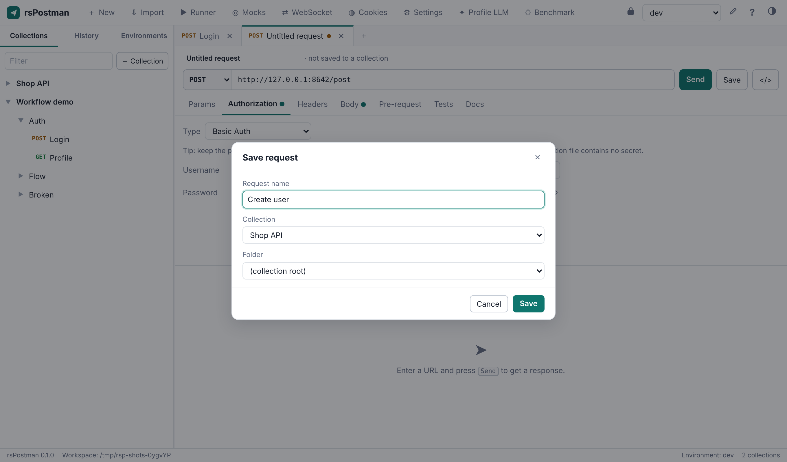

**Save** stores the request in a collection. The first time, a dialog asks for a name, the
collection (or a new one) and optionally a folder. After that, Save updates the stored
request. A request that is not saved yet shows *not saved to a collection* next to its name;
you can still send it.

### Describing a request

The **Docs** section holds a free-text description. It appears in the generated API
documentation (see [Import, export and code snippets](#import-export-and-code-snippets)).

## Reading the response

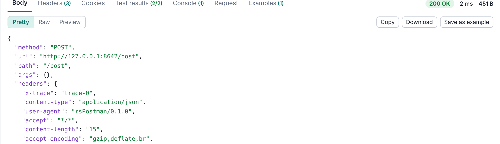

Above the response you see the **status** (green for 2xx, amber for 4xx, red for 5xx), the
**time** the exchange took, the **size** of the body, and the number of redirects that were
followed.

| Section | Shows |
|---|---|
| **Body** | **Pretty** formats and colours JSON and indents XML/HTML; **Raw** shows the text as received; **Preview** renders HTML in a sandbox and displays images. **Copy**, **Download** and **Save as example** are on the right. Binary responses are offered for download instead of being displayed. |
| **Headers** | The response headers. |
| **Cookies** | Cookies set by this response. They are also stored in the [cookie jar](#cookies). |
| **Test results** | The outcome of your [test scripts](#scripts-and-tests). The tab comes to the front when a test fails. |
| **Console** | Output of `console.log` and friends from your scripts. |
| **Request** | The request exactly as it was sent, after variables and authorization were applied. Credentials are hidden until you press **Show credentials**. |
| **Examples** | Saved example responses of this request. |

When something goes wrong before a response arrives – the host cannot be reached, the URL is
invalid, a variable from the vault is unavailable, a pre-request script fails – a red box
explains what happened instead of a response.

### Examples

**Save as example** stores the current response with the request. Examples document what an
endpoint returns, appear in the generated documentation, and are what a
[mock server](#mock-servers) replies with. Manage them in the **Examples** section.

## Collections

A collection is a named tree of folders and requests. It can carry variables, an
authorization setting and scripts that apply to everything inside it.

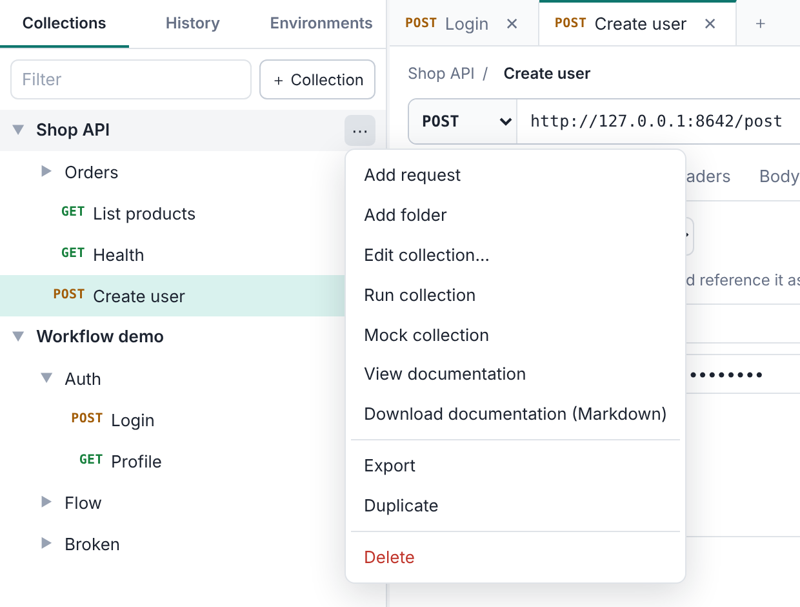

### Working with the tree

- **＋ Collection** creates a collection. Click a collection or folder to expand it, a request
  to open it.
- Every row has a **⋯** menu (it appears when you point at the row):
  - Collection: Add request, Add folder, Edit collection…, Run collection, Mock collection,
    View documentation, Download documentation (Markdown), Export, Duplicate, Delete.
  - Folder: Add request, Add folder, Edit folder…, Run folder, Rename…, Duplicate, Delete.
  - Request: Open, Rename…, Duplicate, Delete.
- **Drag** a request or folder onto a folder to move it inside, or onto another row to place
  it before that row.
- **Filter** narrows the tree to rows whose name or URL contains the text.

Deleting a folder that contains an open request does not lose your work: the tab stays open
as an unsaved request.

### Collection and folder settings

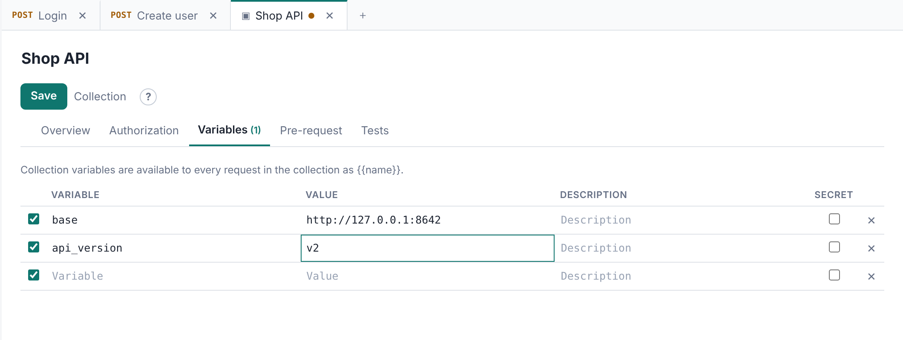

**Edit collection…** (or **Edit folder…**) opens an editor with these sections:

| Section | Purpose |
|---|---|
| **Overview** | Name and description. |
| **Authorization** | Applies to every request below that is set to *Inherit auth from parent* – see [Authorization](#authorization). |
| **Variables** (collections only) | Variables available to all requests of the collection. |
| **Pre-request** and **Tests** | Scripts that run before and after *every* request below – see [Scripts and tests](#scripts-and-tests). |

Press **Save** in the editor to apply the changes.

## Variables and environments

A variable is a named value you reference as `{{name}}`. Use variables for anything that
changes between situations – host names, user ids, tokens – so that a request does not have
to be edited to be used elsewhere.

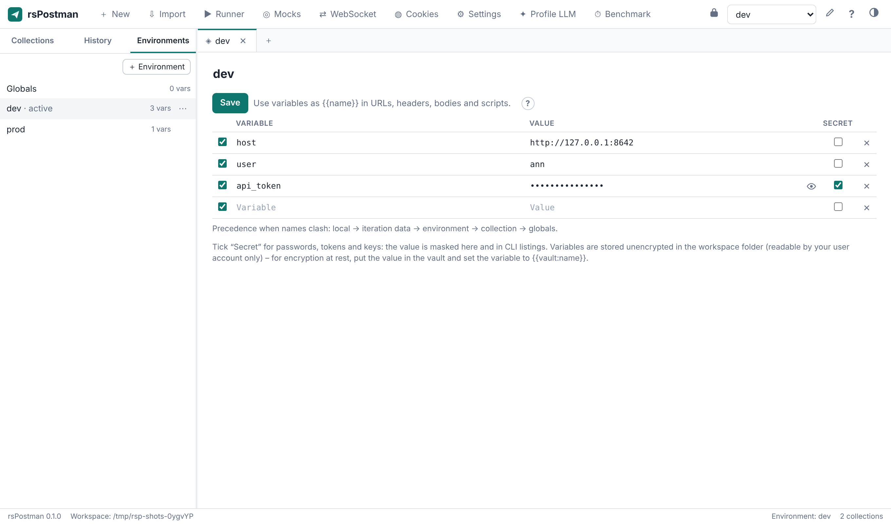

### Where variables live

| Scope | Where to edit | Typical use |
|---|---|---|
| **Globals** | Sidebar → Environments → Globals | Values you need everywhere. |
| **Collection** | Edit collection… → Variables | Values that belong to one API, such as its base URL. |
| **Environment** | Sidebar → Environments | Values that differ per situation: *dev*, *staging*, *prod*. |
| **Iteration data** | A data file in the [runner](#collection-runner) | One row per run. |
| **Local** | Set by a script with `pm.variables.set` | Temporary values during a run. |
| **Vault** | The padlock button – see [Vault and credentials](#vault-and-credentials) | Secrets, written as `{{vault:name}}`. |

When the same name exists in several scopes, the most specific one wins:
local → iteration data → environment → collection → globals.

### Environments

Create an environment with **＋ Environment** in the sidebar, add variables and press **Save**.
Select the *active* environment in the drop-down at the top right; requests then use its
values. **No environment** switches them off. The **⋯** menu of an environment offers
Set active, Export, Duplicate and Delete.

Untick a variable to keep it without using it. A variable that cannot be resolved is sent as
the literal text `{{name}}`, which makes the mistake easy to spot in the **Request** section
of the response.

### Secret variables

Tick **Secret** for passwords, tokens and keys. The value is then shown as dots in the editor
and as `********` in command-line listings. Variables whose name looks like a credential
(`password`, `api_token`, …) are ticked automatically; you can untick them. Secret variables
are masked, not encrypted – for encryption use the [vault](#vault-and-credentials) and set
the variable to `{{vault:name}}`.

### Dynamic variables

Names that start with `$` produce a fresh value every time they are used:

| Variable | Value |
|---|---|
| `{{$guid}}`, `{{$randomUUID}}` | A random UUID. |
| `{{$timestamp}}`, `{{$isoTimestamp}}` | The current time as Unix seconds or ISO 8601. |
| `{{$randomInt}}` | A number from 0 to 1000. |
| `{{$randomEmail}}`, `{{$randomFullName}}`, `{{$randomUserName}}` | Made-up personal data. |
| `{{$randomIP}}`, `{{$randomUrl}}`, `{{$randomHexColor}}`, `{{$randomBoolean}}` | Assorted test values. |

About sixty of these exist, with the same names as in Postman.

## Authorization

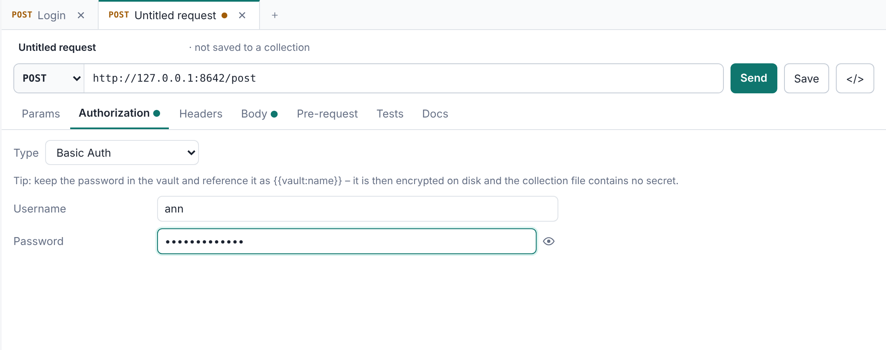

The **Authorization** section adds credentials to a request so that you do not have to build
headers by hand.

| Type | What you enter | What is sent |
|---|---|---|
| **Inherit auth from parent** | Nothing. | Whatever the enclosing folder or collection specifies. |
| **No Auth** | Nothing. | No credentials, even if a parent specifies some. |
| **Basic Auth** | Username, password. | `Authorization: Basic …` |
| **Bearer Token** | Token. | `Authorization: Bearer …` |
| **API Key** | Key name, value, and whether it goes into a header or the query string. | The header or query parameter. |
| **Digest Auth** | Username, password. | The request is repeated with the answer to the server's challenge. |
| **OAuth 2.0** | An access token, or the details to fetch one. | `Authorization: Bearer …` or an `access_token` query parameter. |
| **OAuth 1.0** | Consumer key and secret, token and token secret, signature method. | A signed `Authorization: OAuth …` header or query parameters. |
| **AWS Signature** | Access key, secret key, region, service, optional session token. | An AWS Signature Version 4 `Authorization` header. |
| **JWT Bearer** | Algorithm (HS256/384/512), secret, payload. | A freshly signed token as bearer. |

Secret fields are displayed as dots; the eye button shows the value. A field that contains
only a variable reference such as `{{token}}` or `{{vault:api_token}}` is shown as typed.

### Getting an OAuth 2.0 token

Under **Get a new access token** choose the grant type (client credentials, password
credentials or refresh token), fill in the token URL and client details and press **Get new
access token**. The token is placed in the *Access token* field. Grants that need a browser
login (authorization code, implicit) are not available; paste a token obtained elsewhere.

### Set it once for a whole collection

Put the authorization on the collection (**Edit collection… → Authorization**) and leave the
requests on *Inherit auth from parent*. To change credentials you then edit one place.

## Scripts and tests

Scripts are short JavaScript programs that run around a request.

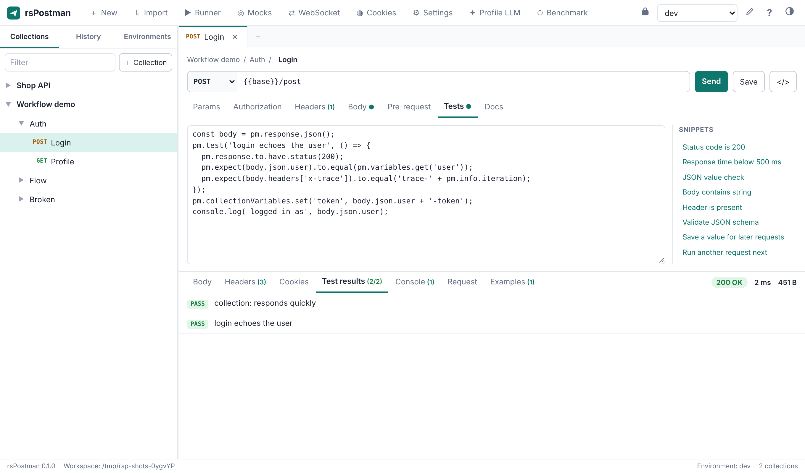

| Section | Runs | Typical use |
|---|---|---|
| **Pre-request** | Before the request is sent. | Compute a value, add a header, fetch a token. |
| **Tests** | After the response arrived. | Check the response, save values for later requests. |

Scripts can be attached to a collection, a folder and a request. They run from the outside
in: collection, then folder, then request.

### Writing tests

The **Snippets** list beside the editor inserts ready-made pieces. A typical test script:

```js
pm.test("Status code is 200", () => {
  pm.response.to.have.status(200);
});

pm.test("The user has an id", () => {
  const body = pm.response.json();
  pm.expect(body.id).to.be.a("number");
});

// keep a value for the next request
pm.environment.set("userId", pm.response.json().id);
```

Each `pm.test` appears in **Test results** as PASS or FAIL with the reason. `console.log`
output goes to **Console**. Variables that a script sets are saved and can be used by later
requests as `{{userId}}`.

A typical pre-request script:

```js
pm.request.headers.upsert({ key: "X-Request-Id", value: pm.variables.replaceIn("{{$guid}}") });
```

The complete list of what scripts can do is in the
[scripting reference](SCRIPTING.md). Scripts cannot read [vault](#vault-and-credentials)
secrets.

## Collection runner

The runner sends every request of a collection or folder in order, runs their scripts and
shows the test results. Open it with **Runner** in the toolbar, or with **Run collection** /
**Run folder** in a **⋯** menu.

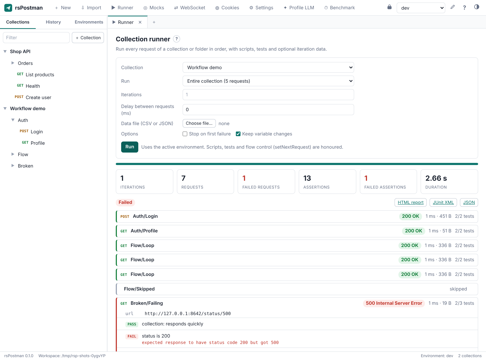

| Option | Meaning |
|---|---|
| **Collection**, **Run** | What to run: the entire collection or one folder. |
| **Iterations** | How many times to repeat the whole sequence. With a data file the default is one iteration per row. |
| **Delay between requests** | A pause in milliseconds. |
| **Data file** | A CSV file with a header row, or a JSON array of objects. Each row provides variables for one iteration (`{{column}}` or `pm.iterationData.get("column")`). |
| **Stop on first failure** | End the run as soon as a request or a test fails. |
| **Keep variable changes** | Save variables that scripts changed during the run. Untick it for a run that leaves no trace. |

While the run is in progress the list fills request by request; **Stop run** ends it. When it
has finished you see the totals, a **Passed** or **Failed** verdict, and buttons for an
**HTML report**, **JUnit XML** (for CI systems) and **JSON**. Click a row to see its tests,
console output and errors; failed rows are expanded for you.

Scripts can steer the run: `pm.execution.setNextRequest("Name")` jumps to a request,
`pm.execution.setNextRequest(null)` stops the run, and `pm.execution.skipRequest()` in a
pre-request script skips the request.

## Mock servers

A mock server answers requests with the [examples](#examples) saved in a collection, so that
an application can be developed before the real API exists.

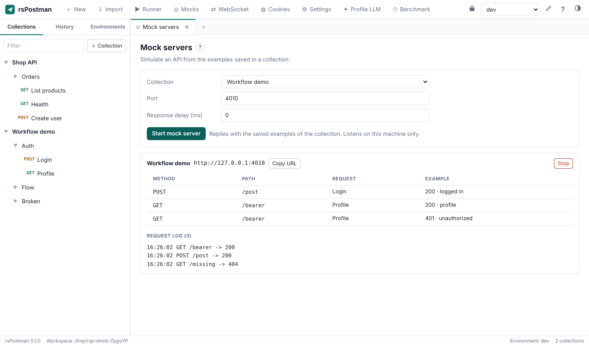

1. Save at least one example for the requests you want to mock.
2. Open **Mocks** (or **Mock collection** in the collection's **⋯** menu), choose the
   collection, optionally a port and a response delay, and press **Start mock server**.
3. Send requests to the address shown. The table lists which paths are served, and the
   request log shows what arrived.

How a request is matched: the method must be the same and the path must fit, where `:name`
segments and unresolved `{{variables}}` in the saved URL match anything. If several examples
fit, the one with matching query parameters wins, then successful (2xx) ones. Add the header
`x-mock-response-code: 404` or `x-mock-response-name: <example name>` to ask for a specific
example. A request that matches nothing gets a 404 with an explanation.

Dynamic variables such as `{{$randomInt}}` in an example body are filled in for every
response. Mock servers listen on this computer only and stop when rsPostman is closed.

## WebSocket

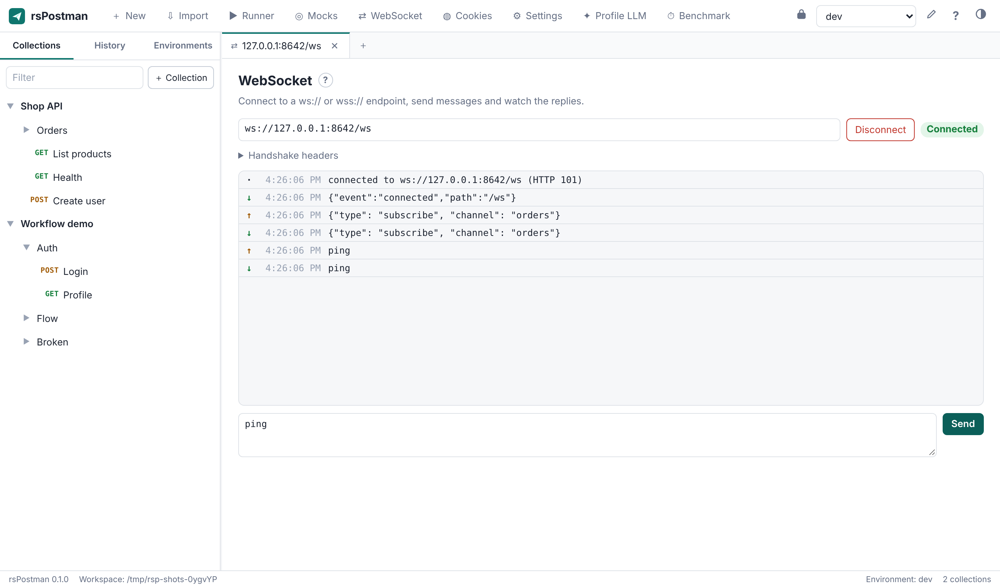

**WebSocket** opens a tab for one connection. Enter a `ws://` or `wss://` address, optionally
add handshake headers, and press **Connect**. Type a message and press **Send** (Ctrl+Enter).
The log shows sent messages with ↑ and received ones with ↓, each with its time. Press
**Disconnect** to close the connection. You can open several WebSocket tabs at once.

## Benchmark

The benchmark repeats a request, or every request of a collection, and measures how fast the
server answers.

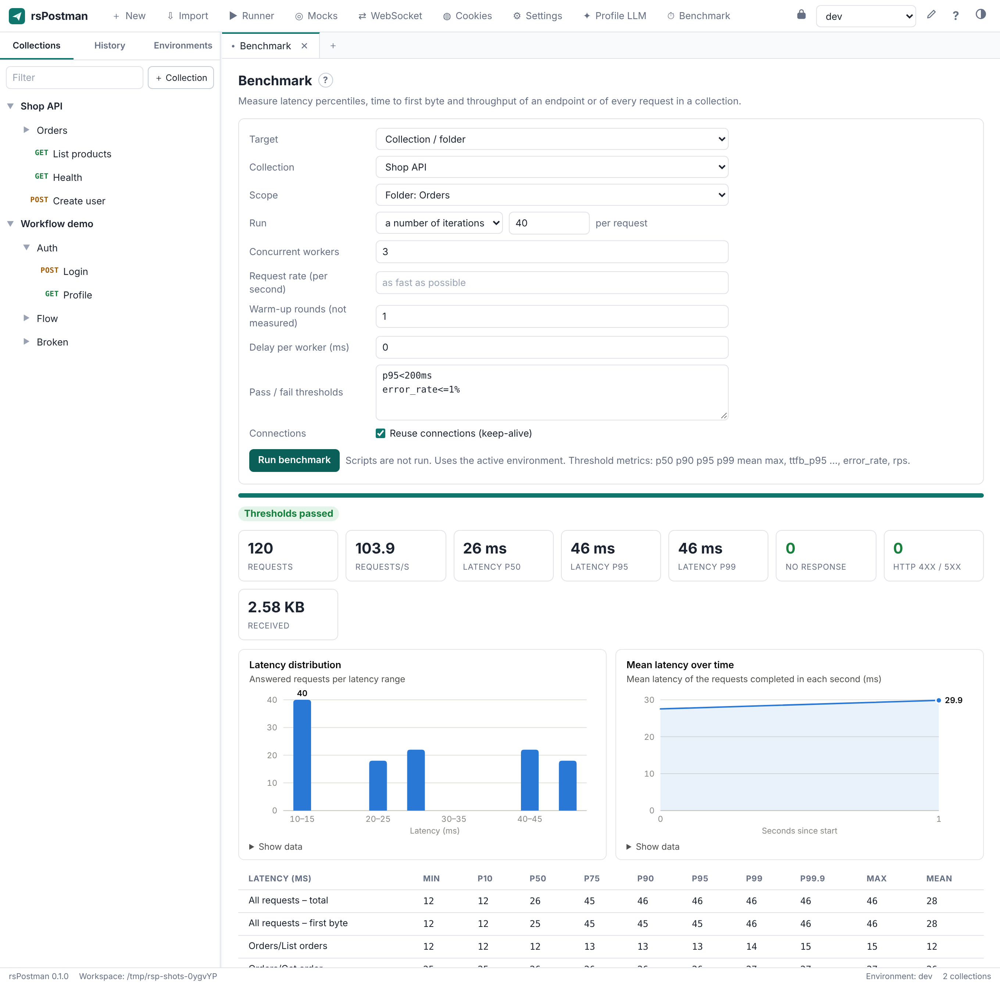

### Options

| Option | Meaning |
|---|---|
| **Target** | One ad-hoc URL, or a collection or folder. |
| **Run** | A number of iterations per request, or a fixed time in seconds. |
| **Concurrent workers** | How many requests are in flight at once (up to 256). |
| **Request rate** | A target number of requests per second for all workers together. Empty means as fast as possible. |
| **Warm-up rounds** | Requests sent before measuring starts, so that connection setup does not distort the numbers. |
| **Delay per worker** | A pause between a worker's requests (alternative to a rate). |
| **Pass / fail thresholds** | Conditions, one per line, that decide the verdict – see below. |
| **Reuse connections** | Keep connections open between requests. Untick it to measure with a new connection each time. |

### Reading the results

- The tiles give the totals: requests, requests per second, the 50th, 95th and 99th latency
  percentile, requests without any response, and responses with an HTTP error status.
- **Latency distribution** shows how many requests fell into each latency range;
  **Mean latency over time** shows whether the server got slower during the run. Point at a
  chart for exact values, or open **Show data** below it for a table.
- The latency table lists percentiles for the total time and for the *time to first byte*
  (how long the server took before it started answering). With a collection there is one row
  per request.
- **Responses** counts each status code.

"P95 = 120 ms" means 95 % of the requests were answered within 120 milliseconds.

### Thresholds

A threshold is a condition such as `p95<200ms`, `error_rate<=1%` or `rps>=50`. Available
metrics: `min`, `mean`, `max`, `p50`, `p75`, `p90`, `p95`, `p99`, `p999`; the same with a
`ttfb_` prefix for the time to first byte; `error_rate` (percent), `errors`, `http_errors`,
`rps` and `requests`. When thresholds are given, the run is marked **Thresholds passed** or
**Thresholds failed**.

### Reports and comparing runs

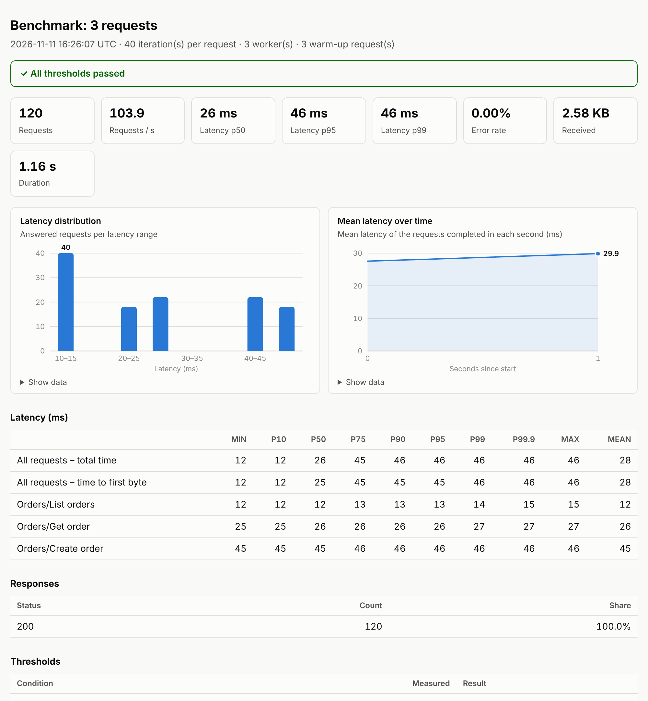

After a run, **HTML report** opens a page you can save or share, **JSON** downloads the full
result and **CSV** every single sample. **Compare with a baseline…** takes the JSON file of
an earlier run and shows what changed; a metric that is more than 10 % (and more than 1 ms)
slower, a throughput that dropped by more than 10 %, or an error rate that rose is flagged
as a regression.

> Benchmarks from one computer show how the server responds to *this* client. At very high
> rates the client itself becomes the limit. Use runs of several seconds and compare runs
> made with the same options. Scripts are not executed during a benchmark.

## Profile an LLM provider

**Profile LLM** checks a chat-completion endpoint that streams its answer (the
OpenAI-compatible format used by many providers).

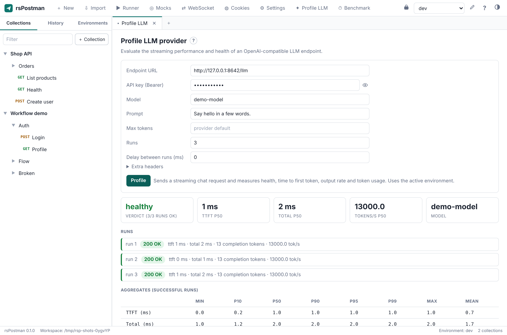

Enter the endpoint URL, the API key (sent as a bearer token and never saved), a model name
and a prompt, choose the number of runs and press **Profile**. For every run you get the
*time to first token*, the total time, the number of tokens or stream events and the output
rate; the summary gives percentiles across the runs and a verdict:

| Verdict | Meaning |
|---|---|
| **healthy** | Every run streamed a complete answer. |
| **degraded** | Some runs failed, returned an empty stream, did not finish properly, or the endpoint did not stream at all. The notes say which. |
| **unhealthy** | No run succeeded. |

Add other headers a provider needs under **Extra headers**.

## Vault and credentials

### The vault

The vault stores passwords, tokens and keys **encrypted** on disk. You unlock it with a
passphrase and use a secret anywhere a variable works by writing `{{vault:name}}`.

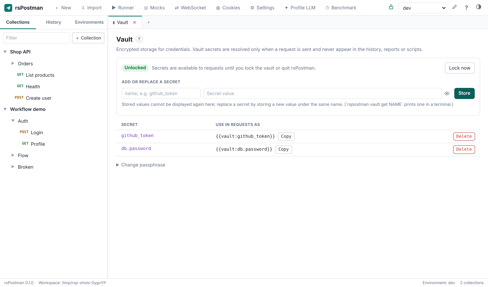

1. Click the **padlock** at the top right. The first time, choose a passphrase of at least
   eight characters and press **Create vault**.
2. Under **Add or replace a secret** enter a name (letters, digits, `_`, `-`, `.`) and the
   value, and press **Store**.
3. Use it: for example put `{{vault:github_token}}` into the token field of Bearer
   authorization, or into the value of an environment variable.

The padlock shows the state: open and green when unlocked, closed when locked. **Lock now**
locks the vault; it is also locked whenever rsPostman is restarted. While it is locked,
requests that need a vault secret are not sent – the error box offers **Unlock the vault**.

What you can rely on:

- Values are encrypted in the workspace file `vault.json`; only the secret *names* are
  readable there. The passphrase is not stored anywhere.
- A vault secret is not shown again in the window, does not appear in the history, in
  reports, in the **Request** section of a response or in script output.
- Stored values can be replaced (store a new value under the same name) or deleted, but not
  displayed. `rspostman vault get NAME` prints one in a terminal.
- **Change passphrase** re-encrypts everything under a new passphrase.

> There is no way to recover a forgotten passphrase. Keep it in a password manager.
> Generated code snippets contain the real secret, because that is their purpose.

### Other credentials

For credentials you type directly into a request or a variable:

- They are shown as dots, with an eye button to reveal them.
- The **history** stores them as `<redacted>`. To keep them, switch on *Keep passwords,
  tokens and keys in the history* in [Settings](#settings).
- Reports and the **Request** section hide them.
- The workspace folder can only be read by your user account.

They are, however, stored as plain text inside the collection or environment file. Prefer the
vault for anything sensitive.

## Cookies

rsPostman keeps cookies like a browser does: cookies set by a response are stored and sent
with later requests to the same site.

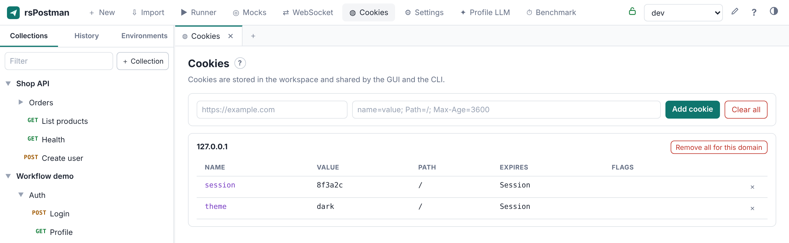

**Cookies** in the toolbar lists the stored cookies by domain. You can delete a single cookie
(✕), all cookies of a domain, or everything (**Clear all**). To add one by hand, enter the
site's URL and the cookie in the form `name=value; Path=/; Max-Age=3600` and press
**Add cookie**. Switch cookie handling off altogether in [Settings](#settings).

## History

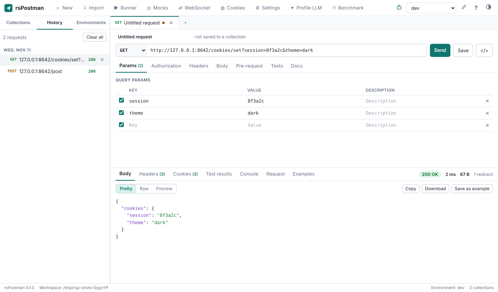

Every request you send is recorded in the **History** tab of the sidebar, newest first, with
its method, address and status. Click an entry to open it in a new tab together with the
response it received. **✕** removes one entry, **Clear all** removes everything.

Credentials are not kept in the history (see [Vault and credentials](#vault-and-credentials));
when you reopen an entry that had some, the affected fields read `<redacted>` and need to be
filled in again. Entries that used `{{variables}}` reopen unchanged.

## Import, export and code snippets

### Import

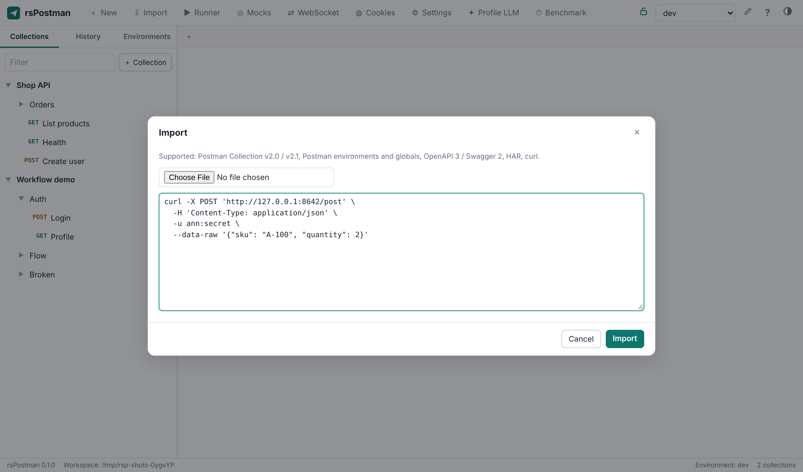

**Import** accepts a file or pasted text and recognises the format:

| Format | Becomes |
|---|---|
| Postman Collection v2.0 / v2.1 | A collection. |
| Postman environment or globals | An environment, or variables merged into Globals. |
| OpenAPI 3 or Swagger 2 (JSON or YAML) | A collection with folders per tag, example bodies and example responses. |
| HAR (browser network export) | A collection with one request per recorded call. |
| A `curl` command | A request in a new tab. |

### Export

**Export** in a collection's or environment's **⋯** menu downloads it as a Postman-compatible
JSON file. Exported files contain whatever credentials were typed into them; secrets kept in
the vault are exported only as `{{vault:name}}` references.

### Code snippets

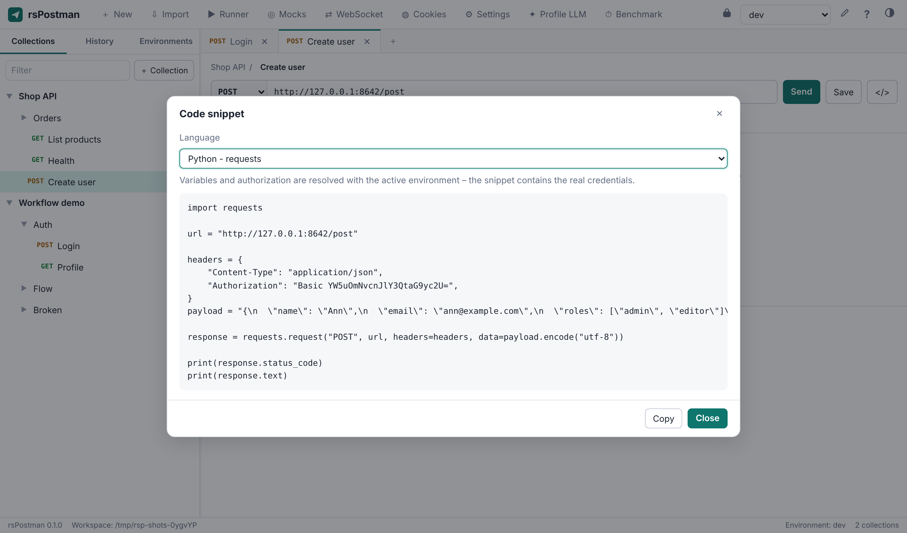

The **</>** button next to Save turns the current request into code: curl, raw HTTP, HTTPie,
Wget, Python (requests), JavaScript (fetch), Node (axios), Go, Rust, Java (OkHttp), C#, PHP,
Ruby or PowerShell. Variables and authorization are filled in with the active environment,
so the snippet runs as it is – and contains the real credentials.

### API documentation

**View documentation** in a collection's **⋯** menu opens a generated page with every
request, its description, parameters, body and examples. **Download documentation
(Markdown)** saves the same as a Markdown file.

## Settings

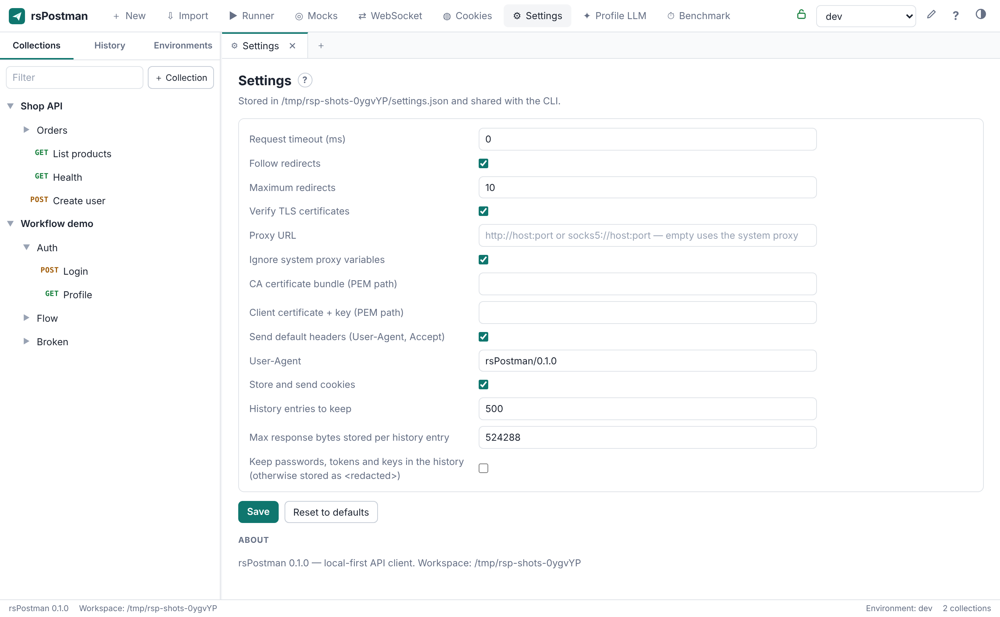

| Setting | Meaning |
|---|---|
| **Request timeout (ms)** | Give up after this long. 0 waits forever. |
| **Follow redirects**, **Maximum redirects** | Whether and how far 3xx responses are followed. |
| **Verify TLS certificates** | Untick only for servers with self-signed certificates that you trust. |
| **Proxy URL** | `http://host:port` or `socks5://host:port`. Empty uses the system proxy settings. |
| **Ignore system proxy variables** | Do not use `HTTP_PROXY` / `HTTPS_PROXY`. |
| **CA certificate bundle** | Path to a PEM file with additional certificate authorities. |
| **Client certificate + key** | Path to a PEM file containing both, for servers that require a client certificate. |
| **Send default headers**, **User-Agent** | The automatic `User-Agent` and `Accept` headers. |
| **Store and send cookies** | Switch the cookie jar on or off. |
| **History entries to keep**, **Max response bytes stored per history entry** | Limits for the history. |
| **Keep passwords, tokens and keys in the history** | Off by default; credentials are stored as `<redacted>`. |

Press **Save** to apply; **Reset to defaults** restores the original values. Settings are
shared with the command line.

## Command line

Everything the window does is also available as a command, which makes rsPostman usable in
scripts and CI pipelines. `rspostman --help` lists the commands and
`rspostman <command> --help` explains every option. Add `--workspace DIR` to any command to
use another workspace.

### Sending requests

```bash
rspostman send https://httpbin.org/get -q page=2 -H 'Accept: application/json'
rspostman send POST https://httpbin.org/post --json '{"name": "Ann"}'
rspostman send https://example.com/upload -F note=hi -F file=@./photo.png
rspostman send https://api.example.com/me -u bob                 # asks for the password
rspostman send https://api.example.com/me --bearer env:API_TOKEN # token from an environment variable
rspostman request Shop "List orders"                             # a saved request
```

The body goes to standard output and the status line to standard error, so the output can be
piped into other tools. Useful options: `-i` shows response headers, `-v` also shows the
request, `-o FILE` saves the body, `-e ENV` selects an environment, `--var key=value`
overrides a variable, `--fail` gives exit status 22 for HTTP errors.

### Commands at a glance

| Command | Purpose |
|---|---|
| `send [METHOD] URL` | Send an ad-hoc request. |
| `request COLLECTION REQUEST` | Send a saved request (with its scripts). |
| `collection list / create / show / delete / rename / duplicate` | Manage collections. |
| `collection add-folder / add-request / remove / move / rename-item` | Edit the tree. |
| `collection set-var / unset-var / set-auth` | Collection variables and authorization. |
| `env list / create / show / set / unset / use / rename / delete` | Environments; `env use NAME` selects the active one, `env set ENV KEY --secret` asks for the value. |
| `globals list / set / unset` | Global variables. |
| `vault init / status / list / set / get / remove / passwd` | The vault. |
| `run COLLECTION` | Run a collection like the runner: `--folder`, `-n`, `-d data.csv`, `--delay`, `--bail`, `--report-json`, `--report-junit`, `--report-html`. Exit status 1 when something failed. |
| `benchmark [METHOD] URL` or `--collection C` | Benchmark: `-n` or `-t 30s`, `-c`, `--rate`, `--warmup`, `--assert 'p95<200ms'`, `--compare base.json`, `--report-json/-csv/-html`. |
| `profile URL` | Profile a streaming LLM endpoint: `--model`, `--prompt`, `-n`, `--bearer`. |
| `mock COLLECTION --port 4010` | Serve saved examples. |
| `monitor COLLECTION --every 5m` | Run a collection repeatedly and log the results. |
| `ws URL -m "message"` | WebSocket: send messages and print replies; without `-m` it is interactive. |
| `import FILE` or `import "curl …"` | Import any supported format. |
| `export collection / env / globals` | Export as Postman-compatible JSON. |
| `codegen LANG -c COLLECTION -r REQUEST` | Generate a code snippet; `codegen --list` shows the languages. |
| `docs COLLECTION -f md` or `-f html` | Generate API documentation. |
| `history list / show / replay / clear` | The history. |
| `cookies list / set / clear` | The cookie jar. |
| `settings show / set / reset` | Settings, e.g. `settings set timeout_ms 5000`. |
| `gui` | Start the graphical interface. |
| `echo` | Start the built-in test server. |

### Keeping credentials off the command line

- `-u USER` asks for the password without showing it; `-u USER:env:NAME` reads it from an
  environment variable, and `RSPOSTMAN_PASSWORD` is used when set.
- `--bearer` and `--api-key` accept `env:NAME`, `@FILE`, or `-` to be asked.
- `{{vault:name}}` works in any argument. The vault passphrase is asked for when needed; in
  scripts and CI set `RSPOSTMAN_VAULT_PASSPHRASE`.

### Using rsPostman in CI

```bash
rspostman import ./api.postman_collection.json
rspostman run "My API" -e staging --report-junit results.xml
rspostman benchmark https://staging.example.com/health -t 20s --rate 20 \
    --assert 'p95<300ms' --assert 'error_rate<=1%'
```

Both commands end with exit status 1 when a test or a threshold fails, which fails the build.

## Keyboard shortcuts

| Keys | Action |
|---|---|
| Ctrl+Enter | Send the request of the current tab (in a WebSocket tab: send the message). |
| Enter in the URL field | Send the request. |
| Ctrl+S | Save the current request, collection, environment or settings. |
| Ctrl+N | New request. |
| Ctrl+Alt+W | Close the current tab. |
| F1 | Open this help. |
| Escape | Close a dialog or menu. |
| Tab in a script or raw body | Insert two spaces. |
| Arrow keys in a menu | Move between entries. |
| Arrow keys on a focused chart | Step through its values. |

On macOS use ⌘ instead of Ctrl.

## Files on disk

```text
~/.rspostman/
  collections/<id>.json     one file per collection (Postman Collection v2.1)
  environments/<id>.json    one file per environment (Postman format)
  globals.json              global variables
  vault.json                encrypted secrets
  history.jsonl             sent requests, one per line, credentials redacted
  cookies.json              the cookie jar
  settings.json             settings
  state.json                the active environment
  monitors/                 logs written by `rspostman monitor`
  uploads/                  files picked in the browser for form-data and binary bodies
```

All files are readable text and can be backed up or copied to another computer. Collection
files can be put under version control and opened with Postman. On Linux and macOS the
folder and its files are created so that only your user account can read them.

## Troubleshooting

| Symptom | What to check |
|---|---|
| **Could not get a response** with "connection refused" or a timeout | Is the address right and the server running? Does a proxy apply? See *Proxy URL* and *Ignore system proxy variables* in [Settings](#settings). |
| A certificate error | The server uses a certificate your system does not trust. Add the authority under *CA certificate bundle*, or untick *Verify TLS certificates* for a server you trust. |
| `{{name}}` is sent literally | The variable is not defined in any scope, is unticked, or the wrong environment is active. The **Request** section of the response shows what was sent. |
| "vault secret … is not available" | The vault is locked (click the padlock) or has no secret with that name. |
| A request works in the window but not from `rspostman run` | The command line uses the active environment unless you pass `-e`; check `rspostman env list`. |
| Tests do not run | Test scripts run only when a response arrived. Look at **Console** and at the error box. |
| A script error mentions `require` | Only `uuid` and `chai` can be loaded in scripts; see the [scripting reference](SCRIPTING.md). |
| A mock server answers 404 | No saved example matches the method and path. The mock page lists the paths it serves. |
| The window says it cannot reach the backend | `rspostman gui` was stopped. Start it again and reload the page. |
| "cannot listen on 127.0.0.1:8686" | Another instance is running. Use `rspostman gui --port 8687`. |

To see which requests the interface makes to its local backend, start it with
`RSPOSTMAN_LOG=1 rspostman gui`.
